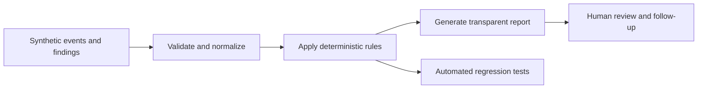

# Security Engineering Labs

**Four original, offline Python demonstrations** that turn security questions into testable, explainable findings. All datasets and identities are fictional. No production systems or third-party APIs are accessed.

[](https://github.com/MatthewAllen1/MatthewAllen1/actions/workflows/security-labs-ci.yml)

| Lab | Primary skill | Proof of work |
|---|---|---|
| [Authentication Detection](./authentication-detection/README.md) | Event normalization, sliding windows, duplicate suppression, ATT&CK mapping | JSONL fixture, CLI, 10 tests |
| [Identity Access Review](./identity-access-review/README.md) | IAM hygiene, privileged-role evaluation, false-positive control | Synthetic accounts, deterministic report, 6 tests |
| [Vulnerability Prioritization](./vulnerability-prioritization/README.md) | Explainable risk scoring and remediation queues | Invented sample findings, validation, 5 tests |
| [File Integrity Monitoring](./file-integrity-monitor/README.md) | File hashing, drift detection, tamper awareness | CLI, safe local sample, 2 tests |

These are **educational prototypes**, not production deployments. No SLA, detection efficacy, false-positive rate, customer impact, or risk reduction is claimed.

## One-minute demo

Requires Python 3.10+ with only the standard library. From the root of this repository:

```bash
python3 security-labs/authentication-detection/detect.py --input security-labs/authentication-detection/sample-events.jsonl
python3 security-labs/identity-access-review/review.py
python3 security-labs/vulnerability-prioritization/prioritize.py
python3 security-labs/file-integrity-monitor/monitor.py --help
```

Run the full regression suite:

```bash
python3 -m unittest discover -s security-labs -p 'test_*.py' -v
```

The [GitHub Actions workflow](../.github/workflows/security-labs-ci.yml) runs compilation, unit tests and sample-based smoke tests on pull requests and relevant pushes with a read-only token and pinned checkout action.

## Engineering approach



See [architecture and design decisions](./ARCHITECTURE.md) and each lab's README for expected behavior, assumptions, testing, and limitations.

## Responsible use and attribution

- All sample identities and IPs are fictional/documentation-only.
- Do not supply confidential logs or real employee data.
- Detection labels reflect **hypotheses for investigation**, not confirmed incidents.
- Samples of CVSS and simulated exploitation flags are for demonstrating triage logic only.
- Code in `security-labs/` is published under the [MIT license](./LICENSE).
- External background references, such as MITRE ATT&CK, are cited where used; no outside code has been copied into these labs.
