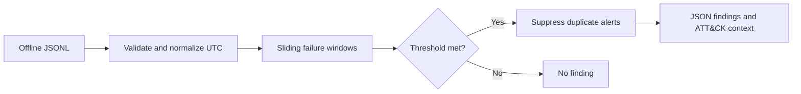

# Authentication Detection — Security Engineering Lab

**Problem:** Repeated sign-in failures against many users from one source can indicate password spraying. Repeated failures against one account warrant separate investigation.

**Implementation:** A standalone, offline Python detector normalizes time zones, orders events, correlates failed logins in a **sliding 10-minute window**, and suppresses duplicate alerts per rule/subject during the same window. No API keys, internet access, external packages, or company data are required.

## Quick start

From the GitHub profile repository root:

```bash
python3 security-labs/authentication-detection/detect.py --input security-labs/authentication-detection/sample-events.jsonl
python3 -m unittest discover -s security-labs/authentication-detection -v
```

Omit `--input` to run built-in synthetic events.

## Data contract

Each JSONL line includes `timestamp` (ISO-8601 with timezone), `user` (fictional account), `ip` (sample source address), and `result` (`success` or `failure`). Invalid records are rejected rather than silently ignored. Files above 5 MB are rejected by the CLI in this demonstration.

## Detection logic

| Rule | Condition | ATT&CK context |
|---|---|---|
| `possible_password_spray` | 3+ distinct identities with failures from one source within 10 minutes | [T1110.003](https://attack.mitre.org/techniques/T1110/003/) |
| `repeated_authentication_failures` | 5+ failures targeting one identity within 10 minutes | [T1110](https://attack.mitre.org/techniques/T1110/) |

Thresholds can be tuned using `--min-users`, `--failure-threshold`, and `--window-minutes`. Output is JSON with timestamps, thresholds and a `needs_investigation` status.



## Analyst follow-up

Check whether log failures reflect a known user typo, a proxy/NAT shared by many people, scripted testing, or a real credential attack. Correlate with identity-provider risk signals, device context, MFA events, and successful sign-ins before concluding compromise.

## Limitations

This detector sees **only source IP, identity, timestamp, and success/failure**; it cannot prove repeated passwords, cannot correlate distributed sources, and does not enrich with geo/IP reputation. NAT, VPNs, and load balancers can create false positives. A source rotating IPs or spraying slowly may evade thresholds. Tests cover positive detections, non-matches, ordering, suppression, and bad inputs; they are not proof of production detection quality.

**Safety:** Synthetic identities use `example.invalid` and documentation-only IP ranges. No real authentication attempts are performed.
