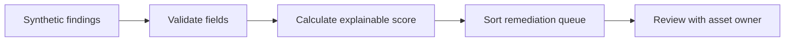

# Risk-Based Vulnerability Prioritization Lab

**Goal:** Demonstrate an explainable remediation queue instead of prioritizing exclusively by severity.

## Run
`python3 security-labs/vulnerability-prioritization/prioritize.py`

## Synthetic risk model

```text
score = (CVSS x 5) + (25 if simulated-known-exploited)
      + (15 if internet-exposed) + (asset-criticality x 2)
```

- CVSS must be a numeric 0–10 value.
- Criticality must be an integer 1–5.
- Exploitation and exposure inputs must be explicit booleans.
- Sorting is deterministic by descending score followed by asset and ID.

**Important:** `in_known_exploited_catalog` is a fictional boolean in the example, **not an actual live CISA KEV lookup**. Sample `DEMO-VULN` IDs are not real CVEs. Scores are bespoke prioritization heuristics, **not official CVSS, EPSS, or a validated enterprise risk model**.

## Triage workflow



Investigate actual exploitability, business exposure, compensating controls, exploit maturity, and change windows before remediation decisions.

## Tests
`python3 -m unittest discover -s security-labs/vulnerability-prioritization -v`. Checks data bounds, ordering, and immutability.
